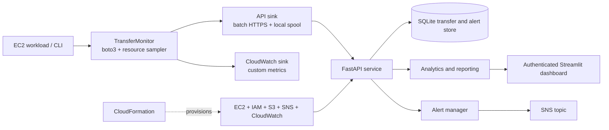

# CloudPulse — Mid-Review Technical Draft

**Project:** CloudPulse v2: EC2–S3 Transfer Performance and Reliability Analyzer  
**Review stage:** Mid-project review  
**Date:** 15 October 2026  
**Status:** Core application and AWS deployment template are implemented; live deployment and evaluation evidence must be added after running in an AWS account.

> Working technical draft for refinement. The abstract below is proposed project-paper text, not a published-paper abstract. Replace bracketed evaluation values with measured results before submission.

## 1. Problem statement

EC2 applications that exchange files with Amazon S3 need to understand transfer throughput, latency, failures, and retries. Infrastructure metrics alone do not explain the outcome of each application-level transfer. CloudPulse instruments individual uploads and downloads, stores event records, analyzes historical behavior, and presents operational metrics, alerts, and recommendations.

## 2. Objectives and scope

- Measure each EC2-to-S3 upload and S3-to-EC2 download, including size, duration, time to first progress, outcome, retry count, error, and selected host resource metrics.
- Persist event-level transfer history and provide aggregate metrics, time series, reliability analysis, alerts, and daily/weekly reports.
- Publish aggregate custom metrics to Amazon CloudWatch and route alerts through Amazon SNS.
- Provide an authenticated web dashboard and a reproducible AWS deployment using CloudFormation.
- Support local development and demonstration without AWS through a deterministic traffic simulator.

**In scope:** one EC2-hosted API/dashboard deployment, one private S3 transfer bucket, SQLite persistence, rule-based alerts and analytics, and CloudWatch/SNS integration.

**Out of scope:** multi-region failover, multi-tenant isolation, auto-remediation, ML-based forecasting, and production horizontal scaling of the SQLite-backed API.

## 3. Requirements

### 3.1 Functional requirements

| ID | Requirement | Current implementation |
|---|---|---|
| FR-1 | Capture per-transfer metadata for S3 uploads and downloads. | `TransferMonitor` wraps boto3 transfers and creates a `TransferRecord`. |
| FR-2 | Calculate throughput, latency, duration, retry, success/failure, and host resource metrics. | Agent/resource sampler plus analytics summaries and time series. |
| FR-3 | Store and query transfer history with time, direction, status, and pagination filters. | FastAPI endpoints backed by SQLite; insert is idempotent by transfer ID. |
| FR-4 | Analyze reliability and identify recurring failures, anomalies, and recent degradation. | Weighted reliability score, grouped failure patterns, robust modified-z-score outliers, recent-vs-baseline comparisons, and evidence-linked rules. |
| FR-5 | Detect threshold violations, persist alerts, suppress duplicates, and notify operators. | Four threshold rules; cooldown/de-duplication; log or SNS notifier. |
| FR-6 | Visualize live status and export reports. | Streamlit/Plotly dashboard refreshes every 30 seconds; JSON/Markdown daily and weekly reports. |
| FR-7 | Continue delivering records during API outages. | Agent API sink spools to local JSONL and retries/replays records; invalid records are isolated to a rejected file. |
| FR-8 | Publish operational metrics and infrastructure alarms to AWS monitoring. | CloudWatch custom metrics, dashboard, upload/download failure alarms, and SNS topic in CloudFormation. |

### 3.2 Non-functional requirements

| ID | Requirement / target | Design or evidence in repository |
|---|---|---|
| NFR-1 Performance | Dashboard data refresh every 30 seconds; analytics over 30,000 records completes under 3 seconds in the performance test. | Dashboard refresh setting and `PerformanceTests` in `tests/test_system.py`. Confirm timing on the target environment. |
| NFR-2 Scale | Support at least 1,000 transfer records/day for the intended demo workload. | Batch ingest supports up to 1,000 records/request; performance test analyzes 30 days × 1,000/day. SQLite is single-writer and not a multi-replica solution. |
| NFR-3 Reliability | Measurement/telemetry errors should not fail the underlying transfer; API outages should not immediately lose telemetry. | Transfer agent returns a record; background sinks and local spool provide best-effort delivery and replay. Spool has a finite configured limit. |
| NFR-4 Security | Authenticated role-based API; least-privilege AWS permissions; encrypted storage; HTTPS ingress; no SSH. | API key roles and hashes, IAM policy, S3 public-access block and encryption, TLS-only bucket policy, IMDSv2, SSM, nginx, encrypted EBS. |
| NFR-5 Maintainability | Keep business logic testable independently of the web framework and persistence adapter. | Framework-free service/analytics layers; SQLite is encapsulated behind `SQLiteStore`; optional dependency groups. |
| NFR-6 Portability | Run locally without an AWS account and deploy to AWS when credentials/account are available. | Simulator, environment-based configuration, Docker Compose, and CloudFormation. |

## 4. System design

### 4.1 Architecture

### 4.2 Data flow

1. The agent starts a transfer and records timestamps, direction, object metadata, and host resource counters.
2. It performs the boto3 operation with bounded exponential backoff and jitter for retryable errors; known permanent errors fail fast. The agent includes time spent in retries/backoff in effective throughput.
3. The completed record is sent to two independent sinks: the CloudPulse API and CloudWatch. Background workers keep slow observability operations off the transfer path. If the API cannot accept records, the API sink stores them in an on-disk JSONL spool and replays them in order.
4. The API validates timestamps and sizes, inserts new transfer IDs once, processes alerts, and serves filtered queries and reports.
5. The dashboard polls summary, time-series, reliability, alert, and history endpoints every 30 seconds.

### 4.3 Measurement and analysis

- **Duration:** completion timestamp minus start timestamp.
- **Throughput:** successful non-empty transfer size in MiB divided by end-to-end duration in seconds. The duration includes retry backoff.
- **Latency:** time from the final attempt's start until the first progress callback; this is a TTFB proxy, not packet-level network latency.
- **Reliability score:** 60% success component, 20% retry-health component, 20% latency-adjusted throughput-stability component. Stability is evaluated within direction and object-size buckets.
- **Anomaly detection:** robust modified z-score against median/MAD per direction and size bucket; minimum sample requirement is 10, threshold is 3.5.
- **Degradation detection:** compares the latest hour against the preceding 24-hour baseline, with minimum recent/baseline sample counts.
- **Failure patterns:** counts error code by direction, size class, and UTC hour; recurring groups require at least three observations.
- **Alerts:** transfer failure, low throughput (objects at least 1 MiB), high latency, and excessive retries. Failure alert cooldown is 60 seconds; other alert rules use the configured cooldown (300 seconds by default).

### 4.4 AWS deployment and security design

CloudFormation provisions a public-subnet EC2 instance, security group restricted to the configured source CIDR on TCP/443, private encrypted S3 bucket, optional S3 gateway endpoint, SNS topic/email subscription, IAM role/profile, CloudWatch dashboard, and native transfer-failure alarms. The EC2 instance uses IMDSv2, encrypted gp3 root storage, and Systems Manager access without an SSH ingress rule. Instance permissions are scoped to the provisioned bucket, the `CloudPulse` CloudWatch namespace, the alert topic, and SSM managed-instance access.

The template uses a self-signed certificate and direct public IPv4 HTTPS endpoint for a demo. A production deployment should use a trusted certificate and a managed ingress design. API secrets are split by service; the API receives hashed API keys while clients receive their own raw keys. The CloudFormation template is intended for review and deployment in a controlled AWS account; no live AWS deployment evidence is included in this draft.

## 5. Tools and technologies

| Area | Tools / technologies | Use |
|---|---|---|
| Language/runtime | Python 3.10+ | Agent, API, analytics, reports, CLI, simulator. |
| AWS SDK | boto3, botocore | S3 transfers, CloudWatch metrics, SNS notifications. |
| API | FastAPI, Uvicorn, Pydantic | Authenticated ingestion, query, reliability, alert, and report endpoints. |
| Persistence | SQLite | Local event and alert history; WAL mode outside in-memory tests. |
| Dashboard | Streamlit, Plotly, pandas | Interactive KPI, trend, history, alert, and recommendation views. |
| Host measurement | psutil | CPU, memory, and network sampling during transfers. |
| Infrastructure | AWS CloudFormation | Repeatable AWS resource creation and configuration. |
| AWS services | EC2, S3, IAM, CloudWatch, SNS, Systems Manager, VPC endpoint | Compute, object storage, permissions, observability, notifications, administration, and private S3 routing. |
| Runtime edge | Amazon Linux 2023, systemd, nginx, OpenSSL | Services, TLS termination, reverse proxy, and service hardening. |
| Local packaging | Docker, Docker Compose, setuptools/pip | Local containerized stack and Python package/CLI installation. |
| Quality assurance | pytest, unittest-compatible tests, httpx | Unit, integration, API, regression, simulator, and performance checks. |

## 6. Proposed research paper abstract

Cloud applications frequently depend on object storage for data exchange, yet infrastructure-level metrics alone provide limited visibility into the performance and reliability of individual application transfers. This project presents CloudPulse, a monitoring and analysis system for file transfers between Amazon EC2 and Amazon S3. A lightweight Python agent instruments uploads and downloads and records transfer size, duration, time-to-first-progress, retries, error codes, and host resource utilization. Event records are delivered to a FastAPI service and Amazon CloudWatch; local disk spooling and idempotent ingestion support recovery from temporary API outages. The service stores event-level data in SQLite and computes throughput and latency summaries, reliability scores, recurring failure patterns, robust statistical anomalies, degradation indicators, and rule-based recommendations. A Streamlit dashboard exposes live operational views, while Amazon SNS and CloudWatch alarms provide alert delivery. The system is deployed through an AWS CloudFormation template with IAM-scoped permissions, encrypted S3 storage, TLS ingress, and Systems Manager access. Evaluation will measure instrumentation overhead, event-delivery behavior during outages, dashboard and analytics latency, and transfer behavior across object sizes and workload conditions. In the current repository, deterministic simulation and a 30,000-record analytics performance test are available; live AWS measurements remain to be collected. [Insert measured results and conclusion after deployment.]

## 7. Literature review (optional)

### 7.1 Object-storage benchmarking

Baun, C., Cocos, H.-N., and Spanou, R.-M. (2017), “OSSperf – a lightweight solution for the performance evaluation of object-based cloud storage services,” *Journal of Cloud Computing*, 6, Article 24. The authors describe a lightweight benchmark for public and private object-storage services. Their results emphasize that object size, protocol overhead, concurrency, and network conditions affect observed throughput; in their S3 measurements, performance also varied with time and network path. This supports measuring both upload and download events and retaining size and time context. CloudPulse differs by focusing on continuous per-transfer production-style monitoring, reliability events, and alerting rather than a standalone comparative benchmark. [Paper](https://link.springer.com/article/10.1186/s13677-017-0096-x)

Liang, G. and Kozat, U. C. (2013), “FAST CLOUD: Pushing the Envelope on Delay Performance of Cloud Storage with Coding,” arXiv:1301.1294. The paper reports randomness in object-storage service times, especially for small and medium objects, and explores parallel connections, chunking, and erasure coding to reduce delay distributions. It also identifies the trade-off: these techniques can increase request load and queueing. This motivates CloudPulse's separate latency and throughput metrics and its size-aware comparisons; a single aggregate average can conceal this behavior. CloudPulse does not implement coding or adaptive concurrency. [Paper](https://arxiv.org/abs/1301.1294)

Durner, D., Leis, V., and Neumann, T. (2023), “Exploiting Cloud Object Storage for High-Performance Analytics,” *Proceedings of the VLDB Endowment*, 16(11), 2769–2782. Their empirical study finds that first-byte latency can dominate small-object access, while bandwidth becomes the limiting factor for sufficiently large requests. They also report substantial variation in observed S3 object bandwidth over time. This supports CloudPulse's latency-adjusted transfer stability analysis, separate size buckets, and recent-versus-baseline degradation checks. Their work focuses on optimizing analytical retrieval; CloudPulse focuses on operational monitoring and failure diagnosis. [Paper](https://doi.org/10.14778/3611479.3611486)

### 7.2 AWS operational guidance

AWS documentation describes S3 request-rate scaling, parallelization, and the possibility of temporary `503 Slow Down` responses while a workload scales. CloudPulse records retry/error data, identifies throttling patterns, and can recommend backoff and workload distribution based on observed failures. AWS CloudWatch alarms support threshold-based state changes and notifications; the project uses native alarms as an independent alert path alongside application-level analysis. [S3 performance guidance](https://docs.aws.amazon.com/AmazonS3/latest/userguide/optimizing-performance.html) · [CloudWatch alarms](https://docs.aws.amazon.com/AmazonCloudWatch/latest/monitoring/CloudWatch_Alarms.html)

### 7.3 Research gap addressed

The cited work establishes methods for benchmarking object storage and demonstrates that latency, object size, concurrency, and time-varying bandwidth influence performance. CloudPulse applies these observations to an operational EC2–S3 workflow: it records transfer-level evidence continuously, correlates failures with request context, combines a database history with CloudWatch aggregate metrics, and surfaces diagnostics through alerts and a dashboard. The project is an engineering system rather than a new storage protocol or a novel anomaly-detection algorithm.

## 8. Evaluation plan and current evidence

### Evaluation questions

1. What instrumentation overhead does the agent add to upload/download duration?
2. How do throughput, time-to-first-progress, retries, and failure rates vary by direction and object-size bucket?
3. Does local spooling replay records in order after an API outage without duplicating stored events?
4. What is the p50/p95 response time for dashboard API queries and analytics on 30,000 records?
5. Do injected throttling, latency, and permission failures produce the expected patterns and alerts?

### Evidence available in the repository

- Deterministic simulator produces seven-day datasets with known failure/degradation patterns.
- Tests cover model validation, analytics, alert rules/cooldowns, storage idempotency, API behavior, sink spooling/replay, and reports.
- Performance test analyzes 30 days × 1,000 records against a three-second budget.
- CloudFormation includes S3 encryption/public access controls, IAM policy, SNS notification path, CloudWatch dashboard, and upload/download failure alarms.

### Evidence to add after AWS deployment

- AWS account/region and deployment date; sanitized CloudFormation stack outputs.
- Screenshots of the dashboard and CloudWatch dashboard/alarms.
- Test workload, object sizes, concurrency, run duration, and number of records collected.
- Measured p50/p95 transfer and API latencies; success rate, retry count, and detected alert/anomaly counts.
- Observed deployment cost or cost estimate with region, instance uptime, object volume, and CloudWatch/SNS usage assumptions.

## 9. Current limitations and next milestones

- SQLite is suitable for a single-host demonstration workload; multi-instance API scaling requires a shared database adapter such as PostgreSQL and deployment changes.
- CPU, memory, and network measurements are host-wide and may include unrelated processes.
- Latency is inferred from the first transfer progress callback, not captured from network packets.
- The AWS template's self-signed certificate is demo-only; production TLS and managed ingress remain deployment decisions.
- Synthetic data validates known logic paths but cannot establish real S3 performance or operational cost.

**Next milestones:** deploy the stack in a course AWS account; run controlled upload/download cases across file-size and concurrency groups; exercise API outage and error scenarios; capture screenshots and measurements; replace the abstract's placeholder with results; align the final report to the course rubric.

## References

1. Baun, C., Cocos, H.-N., & Spanou, R.-M. (2017). OSSperf – a lightweight solution for the performance evaluation of object-based cloud storage services. *Journal of Cloud Computing, 6*, 24. https://doi.org/10.1186/s13677-017-0096-x
2. Liang, G., & Kozat, U. C. (2013). FAST CLOUD: Pushing the Envelope on Delay Performance of Cloud Storage with Coding. arXiv:1301.1294. https://arxiv.org/abs/1301.1294
3. Durner, D., Leis, V., & Neumann, T. (2023). Exploiting Cloud Object Storage for High-Performance Analytics. *Proceedings of the VLDB Endowment, 16*(11), 2769–2782. https://doi.org/10.14778/3611479.3611486
4. Amazon Web Services. Best practices design patterns: Optimizing Amazon S3 performance. https://docs.aws.amazon.com/AmazonS3/latest/userguide/optimizing-performance.html
5. Amazon Web Services. Using Amazon CloudWatch alarms. https://docs.aws.amazon.com/AmazonCloudWatch/latest/monitoring/CloudWatch_Alarms.html
